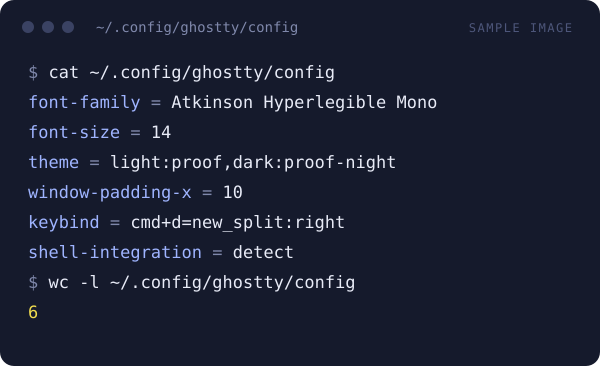

Sample snack. Native, fast, and the defaults are sensible enough that I deleted most of my old terminal config.

Splits and tabs feel like the OS made them, and the font rendering is the best I've had in a terminal. It follows the system light and dark setting with one line.

I miss nothing so far. If that holds for a month, it replaces my old terminal for good.
