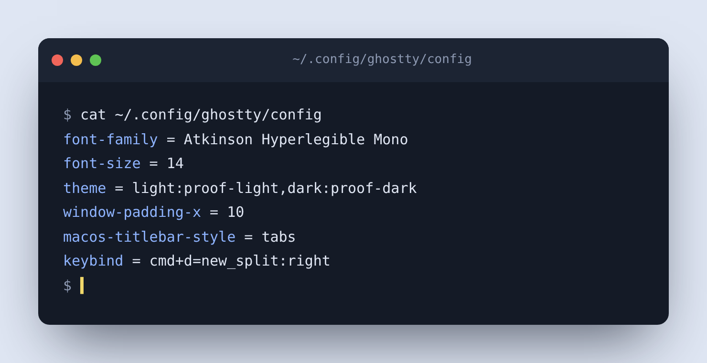

Sample snack. I moved my terminal to Ghostty on a Monday expecting to move back by Friday. I did not. It starts instantly, scrolls a large log without tearing, and looks like it belongs on the machine it runs on.

The part that won me over is how little I had to tell it. My old config was around 80 lines, most of them undoing defaults. This is all of the new one:

Tabs and splits are native, so for small jobs I no longer start a multiplexer at all. I still use one on servers, where it earns its place.

The only thing I miss is the long tail of themes. I ported mine in ten minutes, so that is a thin complaint. Merged.
