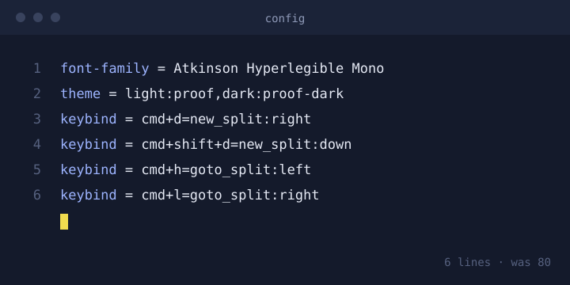
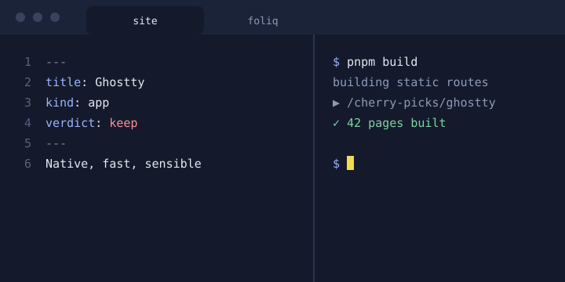

_Sample pick: placeholder text until the real one is written._

Native, fast, sensible defaults. I expected to spend an evening porting my old terminal config. Instead I deleted most of it, because the defaults already did what my config was fighting for.

My config went from 80 lines to 6: a font, a theme, and four key bindings. Everything else I had been carrying around for years turned out to be a workaround for something this terminal does on its own.

Splits and tabs feel like they belong to the system instead of being drawn by the app. I keep the editor on the left and a shell on the right, and I have not opened a multiplexer since.

It is one more config format to remember, which is my only complaint. It replaced my terminal in a day.
