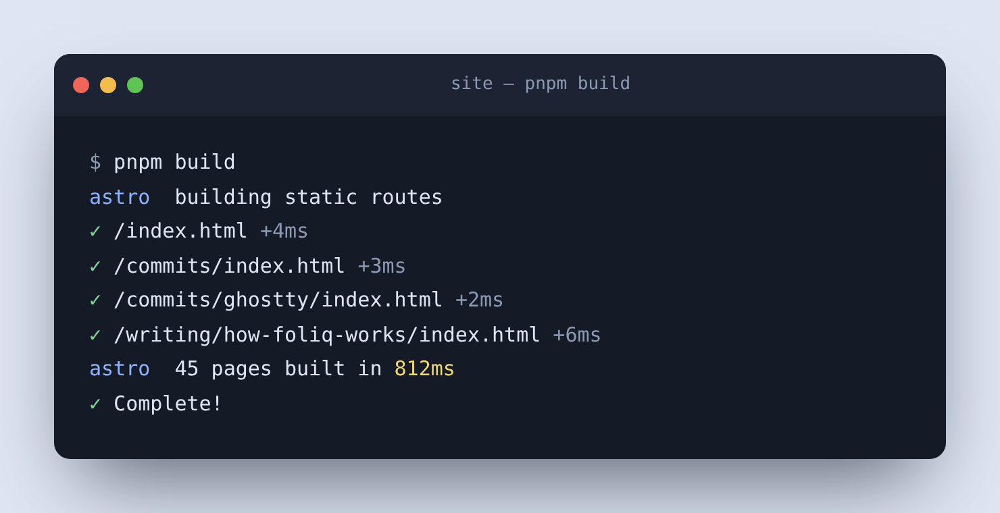

Sample snack. This site runs on Astro 7, so I have a stake in liking it. The headline change is the compiler, now written in Rust and much stricter about what it accepts.

Strict turned out to be the feature. On the first build it refused two templates with unclosed tags that the old compiler had been quietly repairing for me. Both were real bugs: one of them was the reason a list had odd spacing on phones.

Builds are fast enough that I stopped watching them. Two integrations needed a version bump before they would load, which took a few minutes. Merged, obviously.
