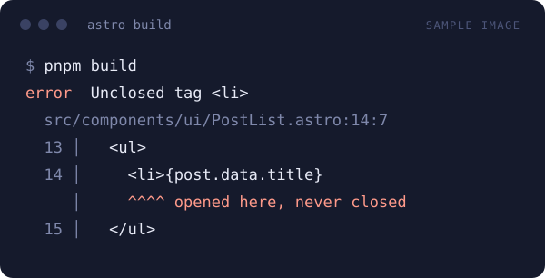

Sample snack. The new Rust compiler is strict about unclosed tags. It refused to build two of my templates, and both times it was right: a stray `<li>` and a paragraph wrapping a `div`.

Builds feel instant. The dev server restarts faster than my editor saves, and content changes reload without losing my scroll position.

Upgrading took one evening, most of it renaming config keys. Keep, without hesitation.
