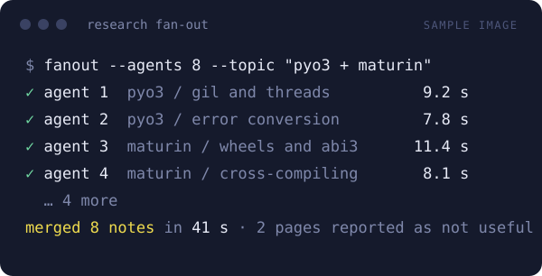

Sample snack. I used it for a research fan-out today: eight agents, each reading a different corner of the PyO3 and maturin docs, then one pass to merge the notes. The whole run finished before I had switched windows.

Tool use held up better than I expected from a small model. It searched with sensible queries, didn't loop, and **said so when a page had nothing useful** instead of padding the summary.

It still loses the thread on long, subtle reasoning, so the merge step stays on a bigger model. For the fan-out part it is now my default.
