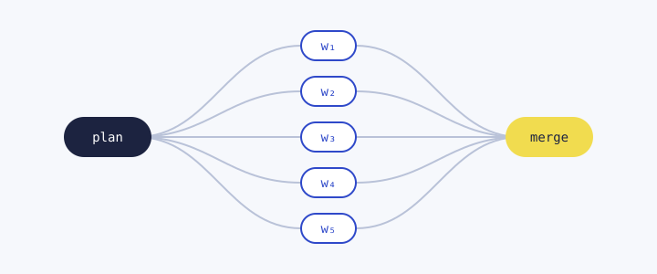

_Sample pick: placeholder text until the real one is written._

Fast enough that I stopped noticing the wait. That changes how I use a model more than any benchmark does: I ask smaller questions, more often, and throw away more answers.

I used it for a research fan-out today. One planner splits the question, a handful of workers each go and read, and the results come back to be merged.

It held up on tool use better than I expected from a small model. The workers called the right tools with the right arguments and stopped when they had enough.

I still hand the final write-up to a bigger model. For everything before that step, this is the one I reach for now.
